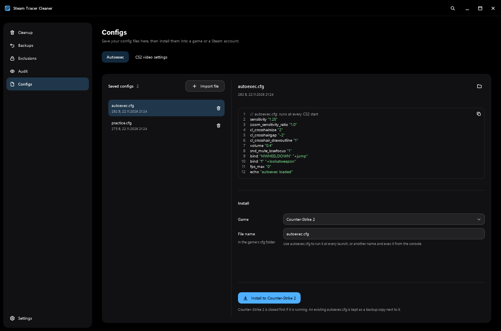
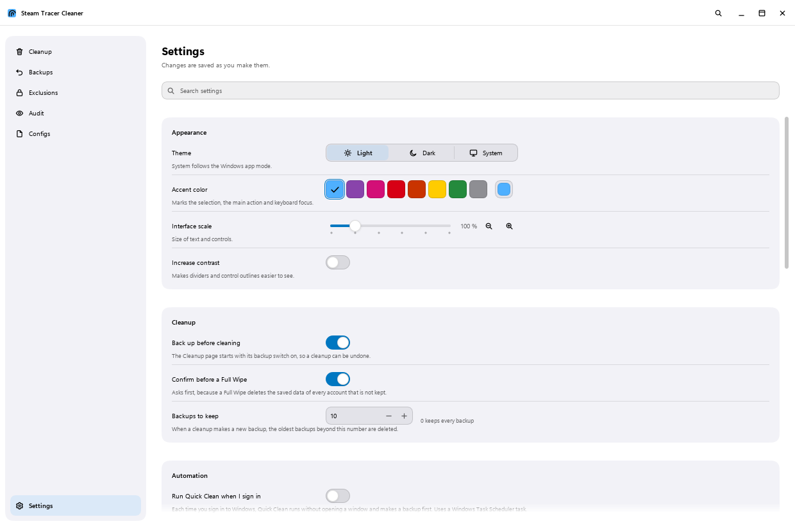

<div align="center">

# Steam Tracer Cleaner

[](https://github.com/velyndev/steam-tracer-cleaner/actions/workflows/ci.yml)
[](../../releases)
[](../../releases)
[](LICENSE)


A native Windows cleaner for what Steam leaves on your PC: caches, logs, crash reports,
saved sign-ins and, if you choose, game saves. It also installs game configs and audits
what Steam and your browsers keep about your accounts.

<details>
<summary><b>Show screenshots</b></summary>
<br>

<br><br>

<br><br>

<br><br>

<br><br>
<sub>The screenshots show generated sample data.</sub>
</details>

You see how much a cleanup removes before it starts, and every cleanup can be backed up
and restored. No installer and no telemetry, and nothing about you leaves your machine.

</div>

## Features

### Interface
- The sidebar holds Cleanup, Backups, Exclusions, Audit and Configs, with Settings at the
  bottom. In a narrow window it shrinks to an icon rail.
- The search icon in the title bar opens the command palette (**Ctrl+K**). It goes to any
  page, re-detects Steam, opens the backups or log folder, opens the repository and switches
  the theme.
- Background work (measuring a cleanup, cleaning, restoring, installing a config) shows as an
  activity item in the title bar, only while it runs. There is no status bar.
- Toasts report results. A toast with an action, such as **Show in Explorer**, still works
  after you move to another page.
- Appearance: theme (Light, Dark, or System, which follows the Windows app mode), an accent
  color, an interface scale from 75 % to 200 %, and an increased contrast option.
- Settings has a search field, and changes are saved as you make them.

### Cleanup
- Pick one of four profiles: **Quick Clean** (caches, logs and crash reports, all of which
  Steam rebuilds), **Account Reset** (adds saved sign-ins, Steam's built-in browser data and
  Steam's cookies in your browsers, which signs accounts out), **Full Wipe** (adds game saves
  and settings, screenshots, controller layouts and non-Steam games in the library), or
  **Game Reset** (only the saves and settings of the games you choose, from a list or by
  AppID).
- The summary card shows the size and the number of items to be removed. It is measured in
  the background whenever you change the profile, an item or an exclusion, so what you see is
  what **Clean** will do.
- **What gets removed** lists all 34 items in seven groups, such as Caches, Logs, and Sign-in
  and account data. Open a group to tick or untick single items. Each item says in plain
  words what it is and what happens when it is gone, and the list can be searched.
- **Review items** opens the full list of files, folders and registry values in the cleanup.
  From there you can copy a path, show it in Explorer, or exclude it from every cleanup.
- **Back up first** is on by default and saves what the cleanup removes. If the backup folder
  cannot be created, the cleanup stops and nothing is removed.
- A cleanup without a backup asks first. So does a Full Wipe, which you can turn off in
  Settings > Cleanup.
- Steam and running Valve and Source games are closed before anything is removed, because
  Steam rewrites some of its files when it exits.
- A running cleanup shows its progress and ends with a result: what was removed, what failed
  and why.

### Backups
- Every cleanup with **Back up first** on creates a restore point, listed with its date, age,
  item count and size.
- **Restore** puts the files and registry values back where they were. It asks first and
  warns when Steam is still running.
- **Show in Explorer** and **Delete backup** sit in each restore point's menu. Deleting asks
  first.
- The newest 10 backups are kept and older ones are deleted when a new one is made. The
  number is set in Settings > Cleanup, and 0 keeps every backup.

### Exclusions
- Exclusions are what no cleanup touches, whatever the profile.
- **Accounts to keep:** switch on any account found on this PC, or add the Steam ID of an
  account that has not signed in here. A kept account keeps its sign-in entry, its `userdata`
  folder, its registry entries, its controller layouts and its profile picture.
- When Steam was set to sign in to an account that gets removed, it signs in to a kept
  account instead.
- **Steam Guard files:** keep the `ssfn` files that some older Steam installs use to skip the
  Steam Guard code.
- **Paths** and **Registry:** files, folders, registry keys (with everything below them) or
  single values written as `KEY::VALUE`. Steam IDs and registry entries are checked as you
  type.
- Accounts can also be excluded from the Audit page, and single paths from **Review items**.

### Audit
- Read-only. It changes nothing on the PC.
- Lists the Steam accounts on this PC, how much data each has on disk and what Steam keeps
  for it, with **Exclude from cleanups** per account.
- Lists the browser profiles whose cookies can keep you signed in to the Steam website. It
  looks for Chrome, Edge, Brave, Vivaldi, Opera and Firefox.
- Lists crash dump folders with the number and size of their files.
- Shows the hardware identifiers Windows uses for this PC (computer name, Machine GUID,
  Machine ID). They are shown, never changed.
- **Export report** saves all of it as a text file.

### Configs
- **Autoexec:** keep `.cfg` files in a library and install one into a Source game, such as
  Counter-Strike 2, Dota 2, Team Fortress 2 or Garry's Mod. The file name in the game's cfg
  folder is yours to choose (`autoexec.cfg` runs at every launch).
- **CS2 video settings:** keep `cs2_video.txt` files and install one for one or more Steam
  accounts on this PC. The result is reported per account.
- Each file has a preview before you install it.
- Installing closes only the target game (Steam stays open), and an existing file is kept as
  a backup copy next to the new one.

### Automation and updates
- **Run Quick Clean when I sign in** adds a Windows Task Scheduler task that runs a Quick
  Clean at each sign-in, without opening a window. It always makes a backup first and keeps
  to the **Backups to keep** number.
- Optional update check at startup, against the GitHub releases page. A newer release shows
  as a notice in the title bar and offers Open releases page, Skip this version, or Later.
- **Re-detect Steam** in Settings > Steam, or in the command palette, finds Steam again after
  it was installed or moved.

### Privacy and security
- Everything stays on your machine. The only network request is the update check, which you
  can turn off.
- A log records each cleanup step with the item, the path and whether it succeeded.
- Portable mode: a `portable.flag` file next to the exe keeps settings, backups, saved configs
  and logs in a `data` folder beside it. Without it they live in
  `%APPDATA%\steam-tracer-cleaner` and `%LOCALAPPDATA%\steam-tracer-cleaner`.
- No telemetry. Details in [SECURITY.md](SECURITY.md).

## Download

Grab the latest `steam-tracer-cleaner.exe` from the [Releases](../../releases) page.
It is statically linked, so no Visual C++ redistributable is required.

- **Requirements:** Windows 10 or 11, 64-bit. The app asks for administrator on launch,
  which it needs to change Steam's folder and registry entries.
- **First run:** the binary is unsigned, so SmartScreen may show "Windows protected
  your PC". Click **More info**, then **Run anyway**.
- **Checksums:** each file on the release page has a `.sha256` file next to it. Compare it
  with `Get-FileHash .\steam-tracer-cleaner.exe -Algorithm SHA256` in PowerShell.
- What changed in each release is in [CHANGELOG.md](CHANGELOG.md).

## Build from source

```powershell
git clone https://github.com/velyndev/steam-tracer-cleaner.git
cd steam-tracer-cleaner
cmake --preset release
cmake --build --preset release
```

Run it from an x64 developer prompt of Visual Studio 2026, with CMake 3.28 or newer. CMake
downloads the Facet UI framework at configure time, so there is no vcpkg or submodule
setup. See [CONTRIBUTING.md](CONTRIBUTING.md) for prerequisites, tests, the project layout
and how a release is made.

## Security

Cleaning deletes files and registry values, so every cleanup is measured and shown first,
can be backed up and restored, skips whatever you exclude, and is written to a log.
Settings, backups and logs are stored only on your machine, and there is no telemetry. To
report a vulnerability or read how cleanups are protected, see [SECURITY.md](SECURITY.md).

## Contributing

Pull requests are welcome. See [CONTRIBUTING.md](CONTRIBUTING.md).

## Disclaimer

This project is for cleaning your own PC and is not affiliated with Valve or Steam. It is
not a spoofer: the Audit page shows hardware identifiers and never changes them. Nothing
here gets around VAC, Easy Anti-Cheat, BattlEye or any other anti-cheat. You are
responsible for how you use this software and for what you choose to remove.

## License

[MIT](LICENSE). The libraries the binary contains, and the notices their licenses ask for,
are listed in [THIRD_PARTY_NOTICES.md](THIRD_PARTY_NOTICES.md).
