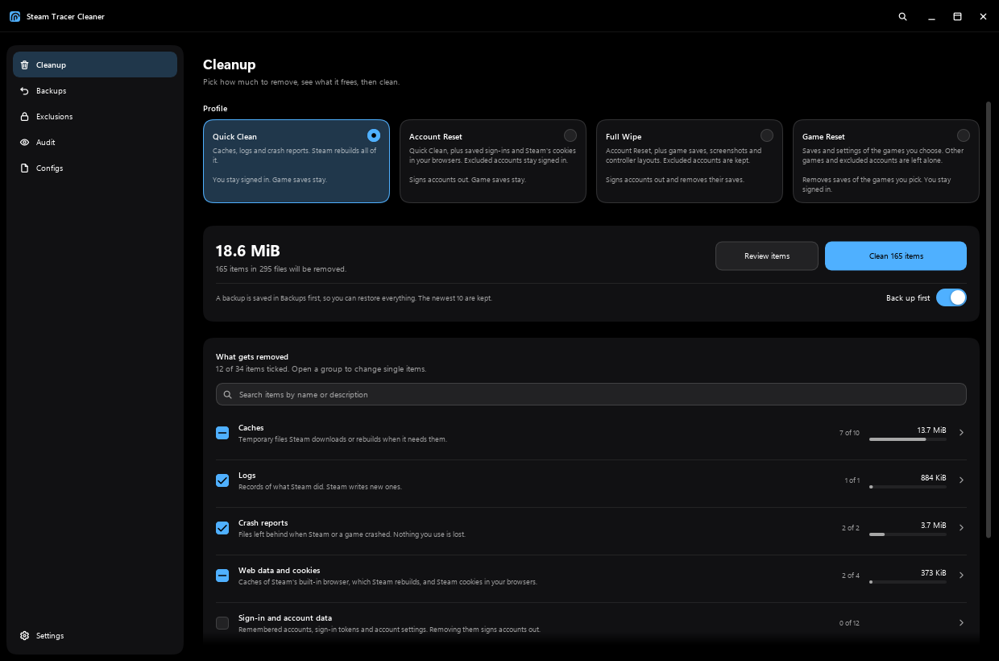
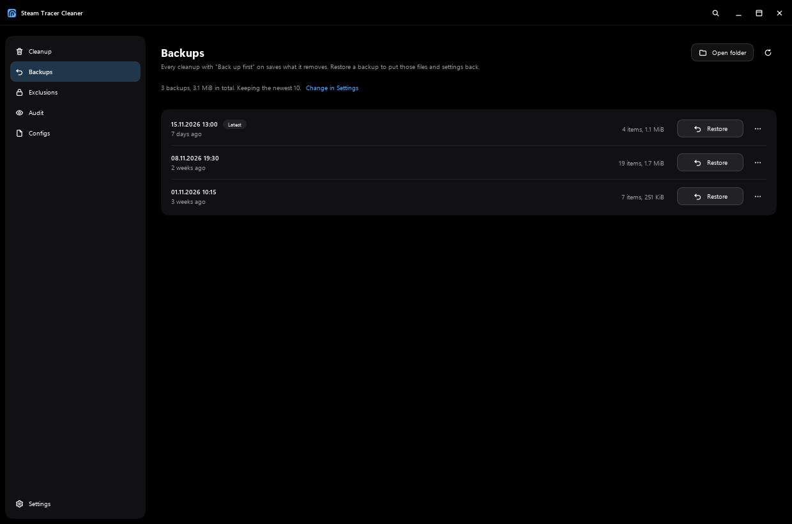
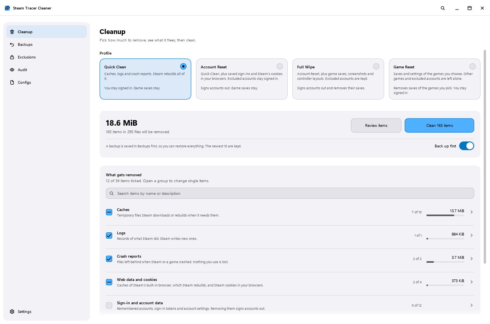

<div align="center">

# Steam Tracer Cleaner

[](https://github.com/velyndev/steam-tracer-cleaner/actions/workflows/ci.yml)
[](https://github.com/velyndev/steam-tracer-cleaner/releases/latest)
[](https://github.com/velyndev/steam-tracer-cleaner/releases)
[](LICENSE)


</div>

Steam Tracer Cleaner removes what Steam leaves behind on your PC: caches, logs, crash reports,
saved sign-ins and, if you want, game saves. You see how much will be removed before you
start, and every cleanup can be backed up and restored.

<p align="center">
  
</p>

<p align="center"><sub>All screenshots use generated sample data, so the sizes, dates and file names in them are examples.</sub></p>

It also installs game config files (autoexec files and CS2 video settings) and shows a
read-only report of what Steam and your browsers keep about your accounts. It is one `.exe`
with no installer, and it sends nothing about you anywhere.

## Download and first run

1. Download `steam-tracer-cleaner.exe` from the
   [latest release](https://github.com/velyndev/steam-tracer-cleaner/releases/latest). There is
   also a `.zip` with the same exe plus the license, changelog and this README.
2. Run it. Windows asks for administrator rights; the app needs them to change Steam's folder
   and registry entries.
3. The exe is not code-signed, so SmartScreen may say "Windows protected your PC". Click
   **More info**, then **Run anyway**.

**Requirements:** Windows 10 or 11, 64-bit. Nothing else to install: the exe is statically
linked, so it does not need the Visual C++ runtime.

**Check your download (optional).** Each file on the release page has a matching `.sha256`
file that holds its SHA-256 hash. In PowerShell:

```powershell
Get-FileHash .\steam-tracer-cleaner.exe -Algorithm SHA256
```

The hash it prints should match the text in `steam-tracer-cleaner.exe.sha256`.

## How to use it

The sidebar has six pages. Most of the time you only need the first one.

### Cleanup

Pick a profile, look at the summary, click **Clean**.

| Profile | What it removes | Signs you out | Removes game saves |
|---|---|---|---|
| **Quick Clean** | Caches, logs and crash reports. Steam rebuilds all of it. | No | No |
| **Account Reset** | Quick Clean, plus saved sign-ins, Steam's built-in browser data and Steam's cookies in your browsers. | Yes, except excluded accounts | No |
| **Full Wipe** | Account Reset, plus game saves and settings, screenshots, controller layouts and non-Steam games in your library. | Yes, except excluded accounts | Yes, except for excluded accounts |
| **Game Reset** | Saves and settings of the games you choose (from a list, or by AppID). | No | Only for the chosen games |

The **summary card** shows how much will be removed and how many items that is. It updates by
itself whenever you change the profile, an item or an exclusion, so what you see is what the
**Clean** button will do.

- **Back up first** (on by default) saves everything the cleanup removes, so you can undo it
  from the Backups page.
- **What gets removed** lists all 34 items in groups such as Caches, Logs, and Sign-in and
  account data. Open a group to tick or untick single items. Each item says in plain words what
  it is and what happens when it is gone. Removing the saved sign-in tokens, for example, means
  Steam asks for your password again.
- **Review items** opens the full list of files, folders and registry values the cleanup will
  touch. From there you can copy a path, show it in Explorer, or exclude it from all cleanups.

The app asks for confirmation before it cleans without a backup, and before a Full Wipe (you can
turn that second one off in Settings). Steam and running Valve and Source games are closed
before anything is removed.

### Backups

<p align="center">
  
</p>

Every cleanup with **Back up first** on creates a restore point here. For each one you can
**Restore** it (the files and settings go back where they were), show it in Explorer, or delete
it. Close Steam before you restore; the app warns you if it is still running.

The newest 10 backups are kept and older ones are deleted when a new one is made. You can change
that number in Settings, and 0 keeps every backup.

### Exclusions

Exclusions are things no cleanup ever touches, whatever profile you pick:

- **Accounts to keep.** Switch on the accounts found on this PC that you want to keep, or type
  the Steam ID (17 digits, starts with 7656) of an account that has not signed in here. A kept
  account keeps its sign-in entry, its userdata folder, its registry entries, its controller
  layouts and its profile picture. If Steam was set to sign in to an account that gets removed,
  it signs in to a kept account instead.
- **Steam Guard files.** Keep the old `ssfn` files that some older Steam installs use to skip
  the Steam Guard code.
- **Paths.** Files or folders to keep. A folder keeps everything inside it.
- **Registry.** Keys (and everything below them) or single values, written as `KEY::VALUE`.

### Audit

A read-only report. It changes nothing on your PC.

- The Steam accounts on this PC and how much data each one has on disk, with an **Exclude from
  cleanups** button for each.
- Browser profiles whose cookies can keep you signed in to the Steam website. It looks for
  Chrome, Edge, Brave, Vivaldi, Opera and Firefox.
- Crash dump folders, with the number and size of the files in them.
- Hardware identifiers Windows uses for this PC: computer name, Machine GUID and Machine ID.
  They are shown, never changed.

**Export report** saves all of it as a text file.

### Configs

<p align="center">
  
</p>

Keep your config files in one place and install them with one click.

- **Autoexec:** import `.cfg` files and install one into a Source game, such as Counter-Strike 2,
  Dota 2, Team Fortress 2 or Garry's Mod. You choose the file name (`autoexec.cfg` runs at every
  launch).
- **CS2 video settings:** import a `cs2_video.txt` and install it for one or more Steam accounts
  on this PC.

Each file has a preview. Before installing, the app closes the target game if it is running
(Steam stays open), and an existing file is kept as a backup copy next to the new one.

### Settings

<p align="center">
  
</p>

Changes are saved as you make them. Settings has a search field and these sections:

| Section | What you can set |
|---|---|
| Appearance | Theme (System, Light or Dark), accent color, interface scale, increased contrast |
| Cleanup | Back up before cleaning, confirm before a Full Wipe, how many backups to keep |
| Automation | Run Quick Clean when you sign in to Windows |
| Updates | Check for updates at startup, check now, the installed version |
| Steam | Whether Steam was found, its folders and accounts, **Re-detect Steam** |
| Storage | Portable mode, and where settings, data and logs are kept |
| About | Version, links to the source code and the releases |

## Is it safe?

Cleaning deletes files and registry values, so the app is built to show first and keep a way
back.

- **You see the result before you clean.** The summary shows the size and number of items, and
  Review items lists every single path and registry value.
- **Backup and restore.** With **Back up first** on, everything removed is copied into a backup
  before it is deleted. If the backup folder cannot be created, the cleanup stops and nothing is
  removed. Restore a backup from the Backups page.
- **Exclusions.** Accounts, files, folders and registry entries you exclude are skipped by every
  profile.
- **Steam is closed first**, because Steam rewrites some of its files when it exits.
- **A log of every action** is kept in the log folder (Settings, Storage, or the command palette).
- **Local only.** The only network request is the optional update check, which asks GitHub for
  the latest release. There is no telemetry.

Details, and how to report a security problem, are in [SECURITY.md](SECURITY.md).

## What it is not

- **Not a spoofer.** The Audit page shows hardware identifiers but never changes them.
- **Not an anti-cheat bypass.** Nothing here gets around VAC, Easy Anti-Cheat, BattlEye or any
  other anti-cheat. It removes files and registry entries that Steam left on your PC.

## Extras

- **Light and dark theme.** It follows the Windows setting unless you pick one.

  

- **Command palette.** Press **Ctrl+K** (or the search icon in the title bar) to go to a page,
  re-detect Steam, open the backups or log folder, or switch the theme.
- **Quick Clean at sign-in.** Turn on "Run Quick Clean when I sign in" in Settings and Windows
  Task Scheduler runs a Quick Clean each time you sign in, without opening a window.
- **Update check.** At startup the app asks GitHub whether a newer release exists and tells you
  if there is one. You can skip a version or turn the check off.
- **Portable mode.** Put an empty file named `portable.flag` next to the exe and restart. Settings,
  backups, saved configs and logs then live in a `data` folder beside the exe instead of in your
  user profile, so you can carry the app on a USB stick.

Without portable mode, settings and exclusions are in `%APPDATA%\steam-tracer-cleaner`, and
backups, saved configs and logs are in `%LOCALAPPDATA%\steam-tracer-cleaner`.

## Build from source

You need Visual Studio 2026 with the C++ workload and CMake 3.28 or newer. From an x64
developer prompt:

```powershell
cmake --preset release
cmake --build --preset release
```

[CONTRIBUTING.md](CONTRIBUTING.md) covers the prerequisites, tests, project layout and how a
release is made.

## More

- [CHANGELOG.md](CHANGELOG.md): what changed in each release
- [SECURITY.md](SECURITY.md): how cleanups are protected, and how to report a vulnerability
- [THIRD_PARTY_NOTICES.md](THIRD_PARTY_NOTICES.md): the libraries inside the exe and their licenses
- [CONTRIBUTING.md](CONTRIBUTING.md): building and changing the app

## License

[MIT](LICENSE)
